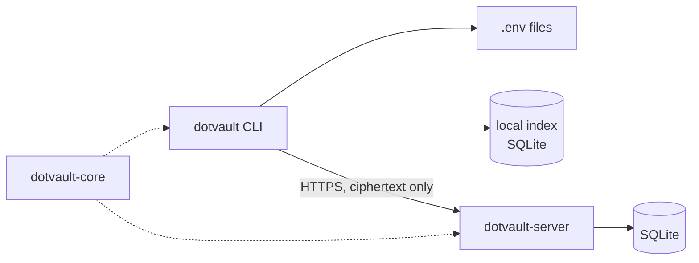
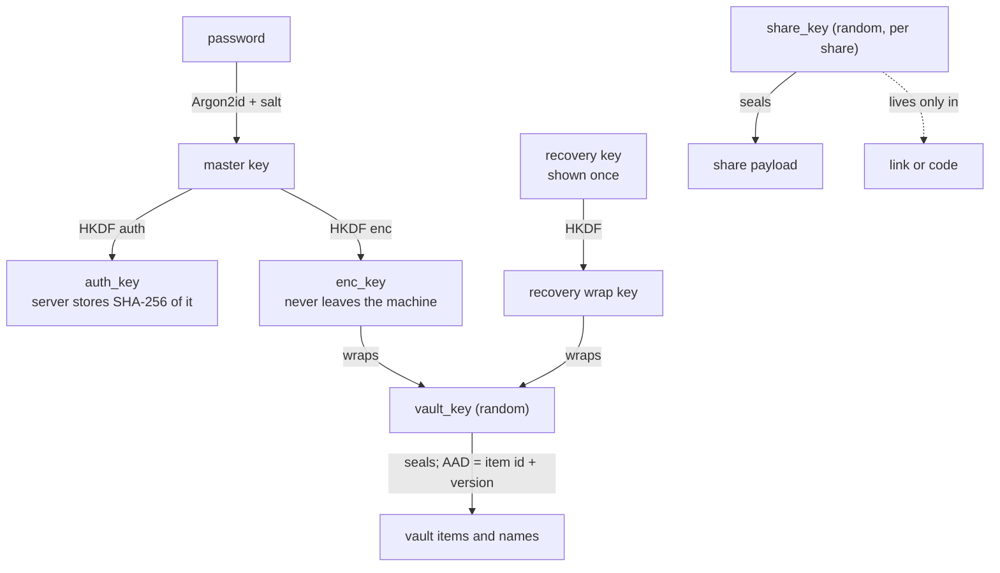

# Architecture

How dotvault is put together. For what it protects and what it does not, see the
[security model](docs/security-model.md).

## Components

One Cargo workspace with three crates.

| Crate | Role |
| :--- | :--- |
| `dotvault-core` | What the CLI and server must agree on: the lossless `.env` parser, env-file classification, crypto, share links and codes, payload formats, and the API types. No heavy I/O. |
| `dotvault-cli` (package and binary `dotvault`) | Everything the user touches: scanning and the local index, filters, local commands, account, vault and sharing commands, terminal output, atomic file writes, the saved login. |
| `dotvault-server` | The service behind the cloud features: accounts, sessions, encrypted vault items and shares, expiry and open limits, the audit log, rate limiting, and the share landing page. |



```text
crates/
  dotvault-core/src/    dotenv.rs  classify.rs  crypto.rs  share_code.rs  payload.rs  api.rs
  dotvault-cli/
    src/                cli.rs  scan.rs  discover.rs  index.rs  filter.rs  resolve.rs
                        keys.rs  clipboard.rs  history.rs  client.rs  session.rs
                        prompt.rs  output.rs  fsutil.rs  config.rs
    src/commands/       ls.rs  view.rs  edit.rs  account.rs  vault.rs  share.rs  cloud.rs
    tests/              local.rs (fixture trees)  cloud.rs (real binary, real server)
  dotvault-server/
    src/                lib.rs  main.rs  auth.rs  ratelimit.rs  middleware.rs  db.rs  janitor.rs
    src/routes/         auth.rs  vault.rs  shares.rs  landing.rs
    migrations/         0001_init.sql
    assets/             share.html  share.js
    tests/              auth  vault  shares  security  logging
install.sh  install.ps1 installers for Linux/macOS and Windows
site/                   download page (index.html)
scripts/                test-install-sh.sh
docs/                   security-model.md  deploy.md
deploy/                 dotvault.service  Caddyfile  Dockerfile  fly.toml  litestream.yml
```

## Finding files

`scan` walks the remembered folders (roots) in parallel, skipping `node_modules`,
`.git`, `target` and similar. When no roots exist yet, the first command that
needs the index (`ls`, `find`, or a project name as a target) saves the whole
computer as the roots and sets `roots_auto = true`: `/` plus local disks under
`/mnt`, `/media` and `/run/media` on Linux, `/` plus local volumes in `/Volumes`
on macOS (`statfs` tells them from network shares, with a timeout), and every
fixed or removable drive on Windows (`GetLogicalDrives` and `GetDriveType`;
network, optical and RAM drives are left out). While `roots_auto` is true each
such command recomputes that list and saves it if the disks changed. Naming a
folder (`scan PATH`, `roots add`, `roots rm`) sets it to false and the list is the
user's. A config from 0.3 or earlier has no `roots_auto`; exactly `[home]` there
is the old automatic default and is widened once, anything else is the user's
(`config::plan_roots`). `DOTVAULT_SCAN_ROOTS` replaces the computed list, which is
how the tests keep away from the real machine.

`discover.rs` holds the skip rules that keep broad roots fast and safe: hidden
and media folders directly inside a home folder, each platform's system folders
(exact paths under every filesystem root, so `/srv/usr` is kept and every
Windows drive's `$RECYCLE.BIN` is skipped, with Windows names compared ignoring
case), and on Linux the network and FUSE mounts from `/proc/mounts`, which can
block. A home folder or filesystem root is never a project. A root named
explicitly is never skipped, even inside a hidden folder.
The time a scan took is stored, and slow scans are repeated less often. It keeps
`.env` and `.env.*` files, marks examples, assigns each file to the nearest
project folder (never above the scanned folder), and stores locations and
variable **names** in `index.db`. Values are never cached. Every read stats the
indexed files: deleted files drop out and changed files are re-read. The index is
disposable and is rebuilt if it is unreadable.

## Reading and copying values

`get` and `show --keys` choose variables with `keys.rs`: a plain name matches
exactly and a glob matches case-sensitively, because variable names are
case-sensitive. One plain name prints the bare value; several names, a glob or
`--kv` print dotenv lines. `-ckv` is expanded to `-c --kv` before parsing, because
clap reads a short cluster as separate letters and `-v` is the version flag.

`get --copy` hands the text to `clipboard.rs`, which starts this same binary as
the hidden command `_clip-hold` in its own process group (detached from the
console on Windows). The value goes in on stdin and the helper answers `ok` or
`error: ...` on its own stdout pipe, so the caller learns whether it worked and
the helper shares no output with the shell. On Linux the helper must stay alive
because the copying process serves paste requests. On every platform it sleeps
for 30 seconds and clears the clipboard only if it still holds the same text.
`arboard` does the platform work, without its Wayland feature: Wayland sessions
use XWayland. Debug builds read `DOTVAULT_CLIPBOARD_FILE` and
`DOTVAULT_CLIPBOARD_SECS` so the tests never touch a real clipboard; release
builds ignore both.

## Secret files

`dotvault-core/src/secrets.rs` is pure (no I/O) and works in two stages so a scan
over millions of files stays cheap. `candidate(name, parent, size)` looks only at
the file name and size, allocates nothing and asks for the parent folder's name
only when a rule needs it, and answers how much to read (nothing, 16 bytes of
magic, up to 16 KiB, or a whole file up to 64 KiB). `confirm(candidate, name,
bytes)` decides from those bytes: PEM and OpenSSH private-key blocks (the OpenSSH
container is parsed for algorithm and cipher), keystore magic numbers, a JSON
object inspected with `serde_json` (invalid, non-object and oversize JSON are not
secrets; its depth limit makes hostile files safe), and line rules for the
credential dotfiles. Placeholders (`${TOKEN}`, `<token>`, empty values) never
count. The result is a `Kind`, a short detail string and, for JSON, the sorted
top-level key names. Nothing else survives.

The walker in `scan.rs` calls `classify` for env files first and `secret_found`
for everything else. `secret_found` skips directories and names that are not
candidates before any I/O, then stats, reads and confirms. `Marks` (the config's
`marked` and `unmarked` paths, behind a file-name set so most files cost one hash
lookup) decide first: unmarked wins, then marked, then detection. The index
stores `kind` and `detail` next to the env fields (schema version 2; an older
index is rebuilt). **`Ctx::records()` returns env files only**, so project
selectors, `find` and `diff` cannot see secret files; `Ctx::all_records()` serves
`ls --secrets`. `refresh_record` re-runs detection for a changed secret file, and
a file that stopped being one drops out.

`discover.rs` adds the credential folders that exist (`~/.ssh`, `~/.aws`,
`~/.docker`, `~/.kube`, `~/.config/gcloud` or `%APPDATA%\gcloud`) to the default
roots, because the hidden-folder rule would skip them; `DOTVAULT_SCAN_ROOTS`
replaces everything as before.

Cloud storage and sharing reuse the existing encrypted item and share formats:
`Payload` (in `payload.rs`) is `Env(EnvPayload)` or `File(FilePayload)`, serialized
untagged so variables look exactly as before and a file carries `"kind": "file"`,
its name, kind, size, mode and bytes in base64. Reading an item or share peeks at
`kind`. The server stores ciphertext and needs no change; the existing limits
(256 KiB per item, 64 KiB per share) apply to the sealed payload. A file arrives
through `write_secret_file`, which checks the declared size against the bytes,
refuses a missing folder or an existing file without `--force`, and writes with
`write_private` (0600 on Unix), ignoring the sender's mode and name. Sharing
key material (`Kind::is_key_material`: SSH and private keys, keystores, service
accounts) asks for confirmation, and without a terminal requires `--yes`.

## History

`history.rs` keeps a numbered version list per (file, variable) in `history.db`
(SQLite), next to but separate from `index.db`: the index is a cache that is
deleted and rebuilt when unreadable and never holds values, while history holds
old and current values, is created owner-only (0600 on Unix) before SQLite opens
it, uses a rollback journal so no `-wal` or `-shm` file can hold a secret, enables
`secure_delete` and compacts after `forget`, and is never deleted on its own (an
unreadable file is an error that leaves it alone). Files are named by canonical
path.

Every write path calls `Ctx::record(path, before, after, action)` after saving the
file: `set`, `unset`, `edit` (the file is read before and after the editor),
`pull`, and `revert`. `history::plan` is the pure core: it diffs the before and
after variables, and when tracking is starting or the file no longer matches the
last record it adds `baseline` and `external` versions first (stamped with the
file's modified time, not now). It plans nothing when no variable changed, and
`has_changes` checks that before the history is even opened, so a command that
changes nothing never creates the file. The recording transaction starts as a
writer (`BEGIN IMMEDIATE`) so two dotvault commands at once wait for each other
instead of failing. A failure to record is a warning, because the file is already
saved. `fingerprint` (in `dotvault-core`) is a six character display tag computed
on the fly and never stored. Cloud history is not part of this: the server keeps
20 whole-file versions per item but has no endpoint to read an old one.

## Keys



| Key | Where it lives |
| :--- | :--- |
| `auth_key` | Sent at login. The server stores `SHA-256(domain + auth_key)`. |
| `enc_key` | Memory only. |
| `vault_key` | Server: only wrapped under `enc_key` and under the recovery key. Client: the session file, unless `login --no-cache-key`. |
| recovery key | Shown once; the user keeps it. |
| `share_key` | Only in the link or code. |

Argon2id defaults to 64 MiB, 3 passes, 4 lanes. The client rejects parameters
reported by the server below 19 MiB or 2 passes, so a hostile server cannot
weaken them. Sealed blobs are `version | nonce | ciphertext | tag` using
XChaCha20-Poly1305; the version byte is authenticated.

## Sharing

```mermaid
sequenceDiagram
    participant A as Owner CLI
    participant S as Server
    participant B as Recipient CLI
    A->>A: pick variables, seal with a random share_key
    A->>S: POST /v1/shares (ciphertext, ttl, max views)
    S-->>A: share id
    A-->>B: link or code (id + share_key), sent out of band
    B->>S: POST /v1/shares/{id}/open (session token)
    S->>S: check revoked, expired, limit; count and log the open
    S-->>B: ciphertext
    B->>B: decrypt with the share_key from the link
    opt keep a copy
        B->>S: POST /v1/shares/{id}/events (save)
    end
    A->>S: GET /v1/shares/{id}/events
```

The link is `https://host/s/<id>#<key>`. The key is in the URL fragment, which
browsers never send, and the code form `dv1.<id>.<key>` never touches a URL. The
open limit is checked and incremented in one SQL statement, so concurrent opens
cannot exceed it.

## Server API

All paths are under `/v1`, JSON, with `Authorization: Bearer <token>` unless
marked. Binary fields are unpadded base64url; times are unix seconds.

| Method and path | Purpose |
| :--- | :--- |
| `POST /auth/register` | Create an account; returns a session. |
| `GET /auth/prelogin?username=` (no auth) | Salt and KDF parameters; a stable fake for unknown names. |
| `POST /auth/login` (no auth) | Log in; returns a session and the wrapped vault key. |
| `POST /auth/logout`, `GET /me` | End the session; who am I. |
| `POST /auth/password` | Change password; ends other sessions. |
| `POST /auth/recover/unlock`, `POST /auth/recover` | Two-step recovery with the recovery key. |
| `GET /vault/items`, `POST /vault/items` | List, create. |
| `GET`, `PUT`, `DELETE /vault/items/{id}` | Read, add a version, soft delete. |
| `POST /shares`, `GET /shares` | Create, list your own. |
| `POST /shares/{id}/open` | Open a share (counts as a view). |
| `DELETE /shares/{id}` | Revoke. |
| `GET /shares/{id}/events`, `POST /shares/{id}/events` | Audit log (owner); report a save. |
| `GET /s/{id}` (no auth, outside `/v1`) | Static page that shows the `open` command. |
| `GET /healthz` (no auth, outside `/v1`) | Liveness. |

Limits: share payload 64 KiB, vault item 256 KiB, 20 versions kept per item,
sessions expire after 30 days of inactivity, shares live 1 minute to 30 days with
1 to 1000 opens. Rate limits per address: 20/min for register, prelogin, login
and recovery; 60/min for opening shares.

## Data model

| Table | Holds |
| :--- | :--- |
| `users` | Username (case-insensitive), hash of the auth key, salt and KDF parameters, wrapped vault key (password and recovery). |
| `sessions` | Hash of each token, device name, expiry. |
| `vault_items` | Per-user id, encrypted name, current version, soft-delete flag. |
| `vault_item_versions` | Encrypted payload per version. |
| `shares` | Encrypted payload, expiry, open limit and count, revocation. |
| `share_events` | Who opened or saved a share, when, and with which client. |
| `meta` | Server-local settings, such as the secret behind fake salts. |

No column can hold a password, vault key, share key or plaintext variable. A test
scans the raw database file, including the write-ahead log, to check that none
appears.

## Design notes

- **One workspace, shared core.** Types, the encryption format and the share code
  format exist once, so a client/server mismatch is a compile error.
- **Lossless parser.** `DotEnv::parse(s).to_string() == s` for every input
  (property-tested). Editing a value re-renders only that line.
- **Client-chosen item ids.** The id is part of what an item's ciphertext is
  bound to, so the server cannot swap ciphertexts or serve an old version as new.
- **Untrusted input.** Text from shares, servers and files is sanitized before it
  is printed, shell formats only emit plain identifier names, and the `.env`
  writer quotes values so a file is safe to `source`. Tests run a real `sh`.
- **Synchronous CLI.** A blocking HTTP client keeps the binary small and startup
  fast. The server is async (tokio).
- **Session in a private file.** `session.json` (mode `0600`, atomic writes). An
  OS keychain backend is not implemented because it could not be tested on every
  platform.
- **Default server.** Used only when neither `--server`, `DOTVAULT_SERVER`, the config
  nor a saved session names one; the CLI prints a notice when it applies, and the first
  successful `register` or `login` saves the choice in the config so a later release
  cannot move existing users. The constant lives in `commands/cloud.rs`.
- **Plain HTTP server.** TLS is the proxy's job. The CLI refuses non-HTTPS
  servers except on loopback.
- **Naming.** The package and binary are `dotvault`; the directory is
  `dotvault-cli` so it sits beside `dotvault-core` and `dotvault-server`.

## Release

[cargo-dist](https://github.com/axodotdev/cargo-dist) builds the CLI from a
version tag (`dist-workspace.toml`, `.github/workflows/release.yml`): archives for
Linux (x86_64, aarch64), macOS (Apple Silicon, Intel) and Windows (x86_64), plus
shell and PowerShell installers. The server ships as a container image
(`deploy/Dockerfile`). Homebrew, winget, Scoop, MSI and deb/rpm packages are not
set up.

`install.sh` (Linux, macOS) and `install.ps1` (Windows) are the documented way to
install. They detect the platform, download `dotvault-<target>.tar.xz` (or `.zip`)
and its `.sha256` from the GitHub release, verify the checksum, and copy the
binary into `~/.local/bin` (Linux, macOS) or `%LOCALAPPDATA%\Programs\dotvault`
(Windows) without elevated rights. CI runs them on Linux, macOS and Windows
against a release assembled locally, including a tampered-checksum case, and
`scripts/test-install-sh.sh` also checks platform detection and the exact release
URLs. The download page in `site/` is published to GitHub Pages by
`.github/workflows/pages.yml`; Pages needs a public repository on the free plan,
so that job only runs when the repository is public.

CI (`.github/workflows/ci.yml`) runs the full test suite on Ubuntu, macOS (Apple
Silicon) and Windows (x86_64), plus formatting, clippy, a binary size limit and
the installers. The Intel macOS and Linux aarch64 builds are produced by the
release pipeline but not exercised by CI.

## Not done yet

OS keychain for the session, per-user storage quotas, a second factor, account
deletion, a browser viewer for share links, sharing to a specific user, an
offline vault cache, servers with a private CA, and an independent security
review.
