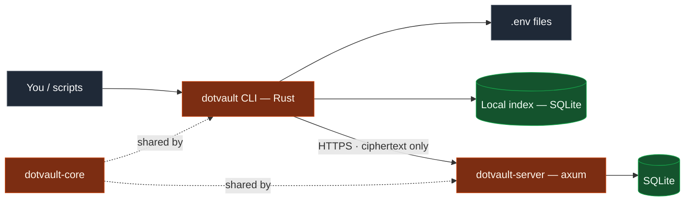
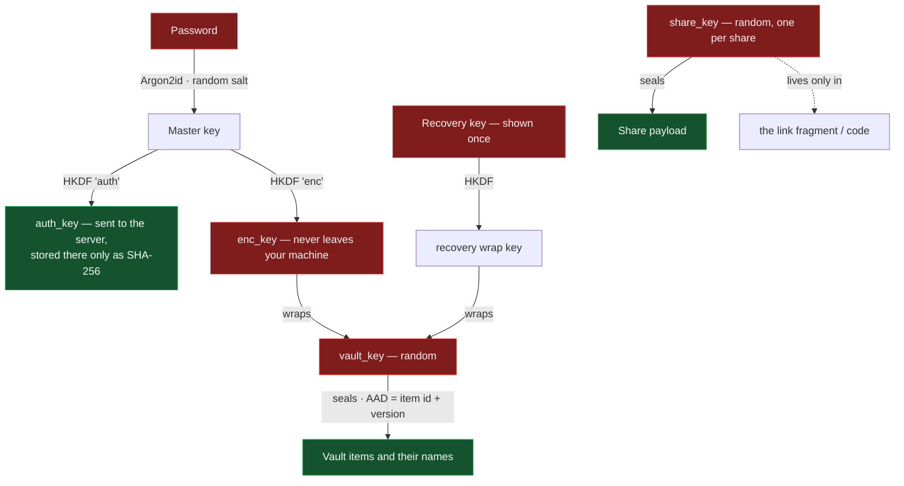
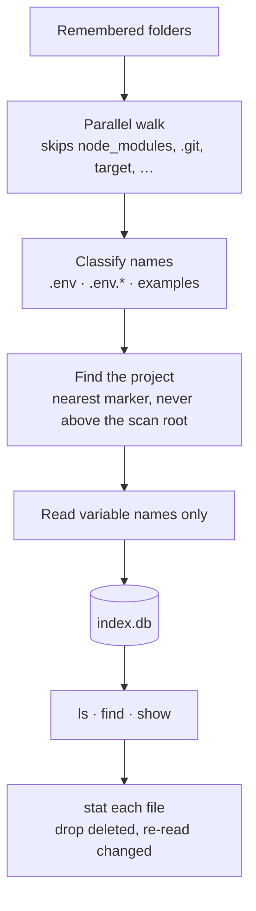
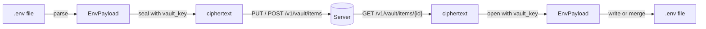
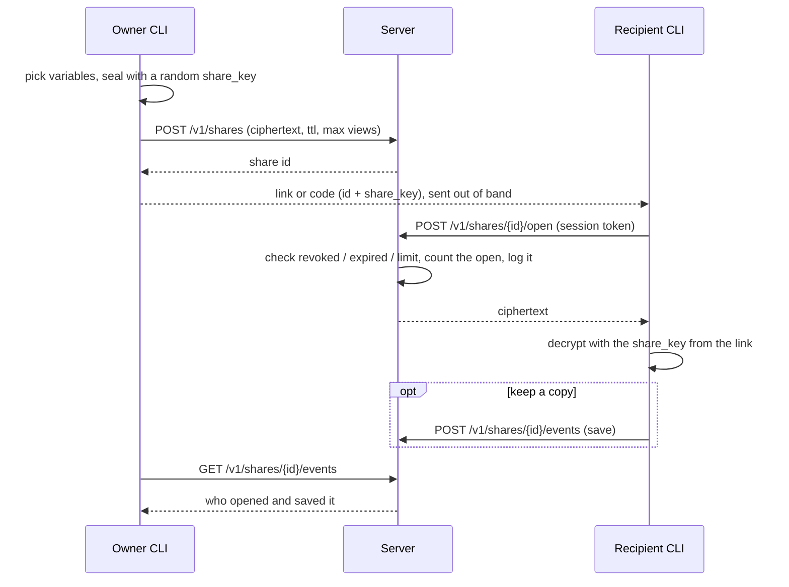

<div align="center">

<pre>
    ┌──────────────────────────────────────────────┐
    │  ●  ●  ●                      dotvault  ─ □ ×
    ├──────────────────────────────────────────────┤
    │                                              │
    │   ARCHITECTURE  &  DESIGN                    │
    │   ───────────────────────                    │
    │                                              │
    │   $ how dotvault is put together_            │
    │                                              │
    └──────────────────────────────────────────────┘
</pre>

**A living design document.**<br/>
How dotvault works and the decisions behind it.

<sub>Decisions here describe the code as it is today. They change as the project learns.</sub>

</div>

---

## Contents

| | | |
| :--- | :--- | :--- |
| [Project](#project) | [Tech Stack](#tech-stack) | [High-Level Architecture](#high-level-architecture) |
| [Responsibilities](#responsibilities) | [Project Structure](#project-structure) | [Design Decisions](#design-decisions) |
| [Key Hierarchy](#key-hierarchy) | [Data Flow](#data-flow) | [Server API](#server-api) |
| [Data Model](#data-model) | [Roadmap](#roadmap) | [Packaging](#packaging) |
| [Development Environment](#development-environment) | [Licensing](#licensing) · [Philosophy](#philosophy) | |

---

## Project

**Name:** dotvault

### Goal

Give developers **one place** to find, read, edit, store and share their `.env`
files — a command-line tool that behaves like a keyring that understands env
files, with an end-to-end encrypted cloud vault and selective sharing on top.

It exists because env files pile up across projects, are hard to find again, and
get handed around over chat. The cloud features are optional: everything local
works with no account.

### Target platforms

| Platform | Status |
| :--- | :--- |
| **Linux** | Built and tested |
| **macOS** | Expected to work — not yet run |
| **Windows** | Expected to work — not yet run |

---

## Tech Stack

| Layer | Choice | Notes |
| :--- | :--- | :--- |
| **CLI** | Rust · clap | One native binary; ~2 ms startup, under 5 MB |
| **Directory walking** | `ignore` | Parallel walker from ripgrep; gitignore handling turned **off**, because `.env` files are usually gitignored |
| **Local index** | SQLite via `rusqlite` | Caches file locations and variable *names*; never values |
| **HTTP client** | `ureq` + rustls | Blocking — no async runtime in the CLI |
| **Crypto** | RustCrypto: `argon2`, `hkdf`, `chacha20poly1305`, `sha2` | XChaCha20-Poly1305, Argon2id |
| **Server** | axum · tokio | Same language as the CLI, so the core crate is shared |
| **Server storage** | SQLite via `sqlx` | Ciphertext in `BLOB` columns — no separate blob storage |
| **Release** | GitHub Actions · cargo-dist | Archives and installers |
| **Container** | Docker, distroless | Server only |

---

## High-Level Architecture



The CLI and the server never share code except through `dotvault-core`, and they
talk only over the HTTP API defined by the types in `core`. The server is never
given anything it could decrypt.

---

## Responsibilities

<table>
<tr>
<th align="left" width="33%">Core — <code>dotvault-core</code></th>
<th align="left" width="33%">CLI — <code>dotvault-cli</code></th>
<th align="left" width="33%">Server — <code>dotvault-server</code></th>
</tr>
<tr>
<td valign="top">

What both sides must agree on.

- Lossless `.env` parser and editor
- Env-file classification
- Argon2id, HKDF, AEAD, key wrapping
- Share links and codes
- Payload formats
- API request and response types

</td>
<td valign="top">

Everything the user touches.

- Scanning and the local index
- Filters and target resolution
- Local commands
- Account, vault and sharing commands
- Terminal output, masking, sanitizing
- Atomic file writing
- Saved login

</td>
<td valign="top">

The service behind the cloud features.

- Accounts and sessions
- Encrypted vault items
- Encrypted shares
- Expiry, open limits, revocation
- Audit log
- Rate limiting
- Share landing page

</td>
</tr>
<tr>
<td valign="top"><sub>No heavy I/O. Nothing in it knows about HTTP servers, terminals or SQLite.</sub></td>
<td valign="top"><sub>Holds every secret in the clear, briefly, because it is the only place that can.</sub></td>
<td valign="top"><sub>Holds <b>no</b> plaintext, no password, no vault key, no share key.</sub></td>
</tr>
</table>

---

## Project Structure

```text
dotvault/
│
├── crates/
│   ├── dotvault-core/
│   │   └── src/
│   │       ├── dotenv.rs         # lossless parser + editor, shell-safe writer
│   │       ├── classify.rs       # .env / .env.* detection, examples, project roots
│   │       ├── crypto.rs         # KDF, AEAD, accounts, recovery key
│   │       ├── share_code.rs     # link / code encoding and parsing
│   │       ├── payload.rs        # EnvPayload — what gets encrypted
│   │       ├── api.rs            # DTOs and limits shared with the server
│   │       └── error.rs
│   │
│   ├── dotvault-cli/             # package `dotvault`, binary `dotvault`
│   │   ├── src/
│   │   │   ├── main.rs  cli.rs
│   │   │   ├── commands/
│   │   │   │   ├── ls.rs         # scan, roots, ls, config
│   │   │   │   ├── view.rs       # show, find, diff
│   │   │   │   ├── edit.rs       # get, set, unset, edit
│   │   │   │   ├── account.rs    # register, login, logout, whoami, passwd, recover
│   │   │   │   ├── vault.rs      # push, pull, vault ls|show|rm
│   │   │   │   ├── share.rs      # share, open, shares
│   │   │   │   └── cloud.rs      # helpers shared by the cloud commands
│   │   │   ├── scan.rs  index.rs  filter.rs  resolve.rs
│   │   │   ├── client.rs  session.rs  prompt.rs
│   │   │   ├── output.rs  fsutil.rs  config.rs
│   │   └── tests/
│   │       ├── local.rs          # local commands against fixture trees
│   │       └── cloud.rs          # real binary ↔ real server, several users
│   │
│   └── dotvault-server/
│       ├── src/
│       │   ├── lib.rs  main.rs   # router, wiring; thin binary
│       │   ├── routes/           # auth, vault, shares, landing
│       │   ├── auth.rs  ratelimit.rs  middleware.rs
│       │   ├── db.rs  config.rs  error.rs  janitor.rs  harness.rs
│       ├── migrations/0001_init.sql
│       ├── assets/               # share landing page (html + js)
│       └── tests/                # auth, vault, shares, security, logging
│
├── docs/
│   ├── security-model.md
│   └── deploy.md
├── deploy/                       # Dockerfile, fly.toml, litestream.yml
├── .github/workflows/            # ci.yml, release.yml (cargo-dist)
├── dist-workspace.toml           # cargo-dist configuration
└── Cargo.toml                    # workspace, release profile
```

---

## Design Decisions

<details open>
<summary><b>One Rust workspace, one shared core</b></summary>

<br/>

The CLI and the server are written in the same language and live in one
repository, so request and response types, the encryption format and the share
code format exist **once**, in `dotvault-core`. A mismatch between client and
server becomes a compile error instead of a runtime surprise.

The CLI and server are also **one product with one release cycle**; splitting
them would add coordination cost with no benefit.

</details>

<details open>
<summary><b>The parser is lossless</b></summary>

<br/>

`DotEnv::parse(s).to_string() == s` for **every** input, which is property-tested.
Comments, blank lines, ordering, quoting style, `export` prefixes, spacing and
line endings are kept. Editing a value re-renders only that one line.

That is what lets `set` and `unset` change a file you have lovingly commented
without disturbing the rest of it.

</details>

<details open>
<summary><b>The index holds names, never values</b></summary>

<br/>

The local index (`index.db`) records where env files are and which variable
**names** they define, so `ls` and `find` are instant without walking the disk.
Values are never cached anywhere. Stale entries are corrected on every read: a
deleted file disappears and a changed file is re-read.

The index is disposable: if it is unreadable or from another version it is
rebuilt.

</details>

<details open>
<summary><b>Everything cloud-side is encrypted before it leaves the machine</b></summary>

<br/>

The server stores ciphertext in SQLite `BLOB` columns, plus hashes of derived
secrets. It cannot read vault items, item names or shares. See
[Key Hierarchy](#key-hierarchy) and the [security model](docs/security-model.md).

Item ids are **chosen by the client**, because the id is part of what the
ciphertext is bound to (AAD: id + version). The server therefore cannot swap
ciphertexts between items or serve an old version as a new one.

</details>

<details open>
<summary><b>A share's key lives in the link, not on the server</b></summary>

<br/>

`https://host/s/<id>#<key>` — the key is in the URL fragment, which browsers
never send to a server; the short code form `dv1.<id>.<key>` never touches a URL.
The server enforces expiry, open limits and revocation, and counts opens in a
single atomic statement so concurrent opens cannot exceed a limit.

Opening a share requires an account, which is what makes the audit log
meaningful.

</details>

<details open>
<summary><b>Content from other people is treated as hostile</b></summary>

<br/>

A share is data someone else chose. Before anything is printed, control
characters and Unicode direction overrides are made visible; shell output only
emits plain identifier names; and the `.env` writer quotes values so a file is
safe to `source`. These properties are covered by tests that run a real `sh`.

</details>

<details open>
<summary><b>The CLI is synchronous</b></summary>

<br/>

No async runtime in the CLI: a blocking HTTP client keeps the binary small and
startup near instant. The server is async (tokio) because it serves many clients.

</details>

<details open>
<summary><b>The session is a private file, for now</b></summary>

<br/>

`session.json` (mode `0600`, atomic writes) holds the session token and, unless
`login --no-cache-key` is used, the vault key. An OS keychain backend is planned
but was not shipped because it could not be tested on every platform. The same
trade-off `gh`, `npm` and `aws` make.

</details>

<details open>
<summary><b>The server speaks plain HTTP; TLS is the proxy's job</b></summary>

<br/>

The server stays small and free of certificate handling. The CLI refuses a
non-`https://` server except on loopback, so a misconfigured deployment fails
loudly instead of leaking tokens.

</details>

<details open>
<summary><b>Package <code>dotvault</code>, directory <code>dotvault-cli</code></b></summary>

<br/>

The binary and the package are both `dotvault` (so release archives are
`dotvault-<target>` and `cargo install dotvault` matches the command). The
directory keeps the `-cli` suffix to sit beside `dotvault-core` and
`dotvault-server`.

</details>

---

## Key Hierarchy



| Key | Made from | Where it lives |
| :--- | :--- | :--- |
| `auth_key` | password → Argon2id → HKDF | Sent at login; the server stores `SHA-256(domain ‖ auth_key)` |
| `enc_key` | password → Argon2id → HKDF | Memory only |
| `vault_key` | random | Server: only wrapped under `enc_key` and under the recovery key. Client: the session file, unless `--no-cache-key` |
| `recovery_key` | random | Shown once; the user keeps it |
| `share_key` | random per share | Only in the link or code |

Argon2id runs at 64 MiB, 3 passes, 4 lanes by default. The client bounds the
parameters the server reports (≥ 19 MiB, ≥ 2 passes) so a hostile server cannot
weaken them.

---

## Data Flow

### Finding files



### Storing and fetching



### Sharing



---

## Server API

All under `/v1`, JSON, `Authorization: Bearer <token>` except where marked.
Binary fields are unpadded base64url; times are unix seconds.

| Area | Method and path | Purpose |
| :--- | :--- | :--- |
| **Auth** | `POST /auth/register` | Create an account; returns a session |
| | `GET /auth/prelogin?username=` *(no auth)* | Salt and KDF parameters; a stable fake for unknown names |
| | `POST /auth/login` *(no auth)* | Log in; returns a session and the wrapped vault key |
| | `POST /auth/logout` · `GET /me` | End the session · who am I |
| | `POST /auth/password` | Change password; ends other sessions |
| | `POST /auth/recover/unlock` · `POST /auth/recover` | Two-step recovery with the recovery key |
| **Vault** | `GET /vault/items` · `POST /vault/items` | List · create |
| | `GET /vault/items/{id}` · `PUT` · `DELETE` | Read · new version · soft delete |
| **Shares** | `POST /shares` · `GET /shares` | Create · list yours |
| | `POST /shares/{id}/open` | Open (counts as a view) |
| | `DELETE /shares/{id}` | Revoke |
| | `GET /shares/{id}/events` · `POST /shares/{id}/events` | Audit log (owner) · report a save |
| **Other** | `GET /s/{id}` *(no auth)* | Static landing page that shows the `open` command |
| | `GET /healthz` *(no auth)* | Liveness |

Limits: share payload ≤ 64 KiB, vault item ≤ 256 KiB, 20 versions kept per item,
sessions last 30 days of inactivity, shares live 1 minute to 30 days with 1–1000
opens. Rate limits per address: 20/min for register, prelogin, login and
recovery; 60/min for opening shares.

---

## Data Model

| Table | Holds |
| :--- | :--- |
| `users` | Username (case-insensitive), `SHA-256` of the auth key, salt and KDF parameters, wrapped vault key (password and recovery) |
| `sessions` | `SHA-256` of each token, device name, expiry |
| `vault_items` | Per-user id, **encrypted** name, current version, soft-delete flag |
| `vault_item_versions` | **Encrypted** payload per version |
| `shares` | **Encrypted** payload, expiry, open limit and count, revocation |
| `share_events` | Who opened or saved a share, when, and with what client |
| `meta` | Server-local settings, e.g. the secret behind fake salts |

There is deliberately no column that could hold a password, a vault key, a share
key or any plaintext variable. A test scans the raw database file, including the
write-ahead log, to check that none appears.

---

## Roadmap

<table>
<tr>
<td valign="top" width="25%">

**Done**

1. Core: parser, crypto, share codes
2. Local commands
3. Server and accounts
4. Cloud vault
5. Sharing
6. Release pipeline *(configured)*

</td>
<td valign="top" width="25%">

**Next — hardening**

- Run CI and the release pipeline for real
- Verify macOS and Windows
- OS keychain for the session
- Per-user storage quotas
- Independent security review

</td>
<td valign="top" width="25%">

**Later — features**

- Browser viewer for share links
- Share to a specific user
- Passphrase-protected shares
- Offline vault cache and sync
- `dotvault run -- <cmd>`

</td>
<td valign="top" width="25%">

**Later — scale**

- Teams and organizations
- Second factor
- Account deletion
- Private-CA servers
- A TUI

</td>
</tr>
</table>

---

## Packaging

The CLI is a single binary built by [cargo-dist](https://github.com/axodotdev/cargo-dist)
from a version tag. The server ships as a container image, not as release
archives.

```bash
cargo install --path crates/dotvault-cli --locked   # from source
dist plan                                           # what a release would contain
```

### Outputs

| Platform | Artifacts |
| :--- | :--- |
| **Linux** | `.tar.xz` — x86_64, aarch64 |
| **macOS** | `.tar.xz` — Apple Silicon, Intel |
| **Windows** | `.zip` — x86_64 |
| **Installers** | `dotvault-installer.sh`, `dotvault-installer.ps1` |
| **Server** | Docker image (`deploy/Dockerfile`) |

### Not set up yet

Homebrew · winget · Scoop · MSI · `.deb` / `.rpm` — each needs an account,
tap or signing secret that only the maintainer can provide.

---

## Development Environment

### Required

| Tool | Notes |
| :--- | :--- |
| **Rust** + **Cargo** | 1.85+ |
| **A C compiler** | The bundled SQLite and the TLS library build C code |

```bash
rustup component add rustfmt clippy
```

### Optional

| Tool | For |
| :--- | :--- |
| `just` | Shortcuts in the `justfile` |
| `cargo-dist` | Changing the release pipeline |
| Docker | Building the server image |

See [CONTRIBUTING.md](CONTRIBUTING.md) for the full setup and the checks CI runs.

---

## Licensing

Dual-licensed under **[MIT](LICENSE-MIT)** or **[Apache-2.0](LICENSE-APACHE)**, at
your option.

| Allowed | Notes |
| :--- | :--- |
| Personal and commercial use | Both licenses are permissive |
| Forks and redistribution | Keep the copyright and license notices |
| Contributions | Dual-licensed on the same terms |

---

## Philosophy

dotvault is meant to be the **boring, trustworthy** way to handle env files:
fast enough to forget about, careful with your files, and honest about what it
protects. Secrets never leave your machine in a form the server can read, and
anything that arrives from someone else is treated as untrusted.

<div align="center">

<sub>◇ ─────────────── ◇ ─────────────── ◇</sub>

<sub><b>dotvault</b> · <a href="./README.md">README</a> · <a href="./CONTRIBUTING.md">Contributing</a> · <a href="./docs/security-model.md">Security model</a></sub>

<br/>

</div>
